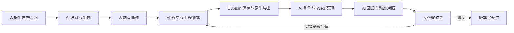

# AI 全流程制作 Live2D

**从角色设计、AI 出图与精修，到原生 Cubism 绑定、九个动作、统一换装和 Web 接入。**

*An end-to-end, AI-driven Live2D production workflow for AI Builders.*

我们用 AI Agent 贯穿 OC 娘的制作：讨论设计、生成候选图、修正素材、编写拆层与绑定脚本、组织原生工程、实现动作与渲染、生成检查程序，再根据人的视觉反馈迭代。这里记录的是这条完整制作链，以及它怎样一步步从“能动”走到“能接入产品”。

**“全流程使用 AI”在这里的具体分工：** 人提出角色方向、选择候选并确认画面；AI 执行设计探索、美术迭代、工程实现和验证；Cubism 官方工具负责相应的编辑、保存与原生导出。制作期间，许可与试用启用由用户完成。

**适合读者：** 想把 AI 生成的角色做成可交互产品的 AI Builder、独立开发者，以及希望把 AI 接入现有工作流的美术和技术美术。阅读不需要取得 OC 娘资产。

## 先看 AI 实际做了什么

| 制作阶段 | AI 的实际工作 | 交付与确认 |
|---|---|---|
| 角色与服装设计 | 根据角色性格生成日常、暗夜与发型候选 | 人选择方向，锁定身份与五官 |
| 出图、拆层与精修 | 生成/编辑底图，编写遮罩、配准、补全与打包脚本 | 回合成、透明边缘与同角度对照 |
| 原生绑定 | 编写网格、关键形采样、工程整理与检查程序 | 官方 Editor 保存导出，Core 检查 |
| 动作与表情 | 实现九向跟随、九动作、眨眼、发尾和动作衔接 | 全身动态与五官/关节近景 |
| 单模型与换装 | 整合主模型，建立发型/服装/饰品的全动作覆盖 | 日常/暗夜统一切换，包含崇拜 |
| Web 产品接入 | 编写宿主控制、高清渲染、主题和双向转场 | 实际页面同尺寸动态验收 |
| 排错与交付 | 定位缺陷、写回归检查、组织版本与资源清单 | 人确认视觉结果，保留回退基线 |

**推荐从这里读：** [我们怎样用 AI 做完整个流程](docs/00-ai-pipeline.md) → [AI Builder 起步路线](docs/13-ai-builder-quickstart.md) → [可复制的 Agent 任务模板](templates/ai-task.md)。

本仓库公开工作方法、教学示例和检查模板。角色原画、PSD、CMO3、MOC3、完整项目脚本与 Cubism Core 不在本次开源范围；如何把经验迁移到自己的角色，见起步路线。

## 第一阶段做到的结果

- 一个原生主模型承载九类表现：待机、翻书、挥手、思考、鼓励、倾听、失落、害羞、崇拜。其中待机是持续状态，其他是可进入和退出的动作。
- 小幅九向转头、头身与眼睛跟随、眨眼和发尾轻摆。
- 日常与暗夜造型全动作联动，主题切换配合追光登场与翻页迎晨。
- 同尺寸高清渲染、全身与近景对照、参数与资产回归检查。

以上是截至 2026-10-20 的第一阶段结果，当前公开仓库提供的是流程与独立教学示例。技术实现、验证范围和宿主依赖见[证据记录](references/project-evidence.md)。

**2026-10-22 补充：暗夜开始作为独立角色制作。** 新待机、脸部与动作不再强套日常的甜美表演。本轮新增[暗夜经验与旧结论修订](docs/14-night-character-lessons.md)，包括参考角度驱动的侧脸、肘部最小修复、动作语义与有约束的中途退出。早期“全动作换装完成”不能解释为新版暗夜的全部独立动作已完成；每项进度见[后续证据快照](references/night-character-evidence.md)。

我们也公开踩坑过程：转头把脸拉扁、眼睛失去神态、肩袖像贴片、掉帧让动作变慢、换装漏掉混合袖口、深色背景露白边，以及预览补偿与原生修复不一致。

## 从哪里开始

| 你的目标 | 建议阅读 |
|---|---|
| 想了解全流程 AI 制作怎么落地 | [AI 制作实录](docs/00-ai-pipeline.md) |
| 想让 Agent 帮自己做第一个角色 | [AI Builder 起步路线](docs/13-ai-builder-quickstart.md)与[任务模板](templates/ai-task.md) |
| 第一次做可交付模型 | [制作流程与交付边界](docs/01-workflow.md) → [拆层与素材](docs/02-artwork.md) → [原生导出](docs/09-native-delivery.md) |
| 头部像平移、脸被压扁 | [九向转头、眼神与头身跟随](docs/03-head-and-eyes.md) |
| 手太扁、肩袖断开、脖子不自然 | [手部与身体接缝](docs/04-body-and-hands.md) |
| 动作慢、切换变色、回不到待机 | [动作与时间系统](docs/05-motion-and-time.md) |
| 想做统一换装 | [单模型与全动作外观](docs/06-appearance.md) |
| 新角色不能再套旧脸，或想知道哪些旧结论变了 | [暗夜独立角色：新增经验与旧结论修订](docs/14-night-character-lessons.md) |
| 接入网页后变糊 | [高清、透明度与性能](docs/07-rendering.md) |
| 想做日夜双向转场 | [主题转场](docs/08-transitions.md) |
| 想了解我们实际用了哪些工具、调研过什么 | [AI 制作证据](references/ai-evidence.md)与[工具方案调研](docs/11-research.md) |
| 已有问题，直接查修法 | [故障速查表](docs/12-troubleshooting.md) |

## 阅读地图

**主线：** [AI 全流程制作实录](docs/00-ai-pipeline.md) · [AI Builder 起步路线](docs/13-ai-builder-quickstart.md)

**专题：**

1. [制作流程与交付边界](docs/01-workflow.md)
2. [拆层、补全与局部精修](docs/02-artwork.md)
3. [九向转头、眼神与头身跟随](docs/03-head-and-eyes.md)
4. [头颈比例、手部与衣料接缝](docs/04-body-and-hands.md)
5. [表情、动作衔接与三个时钟](docs/05-motion-and-time.md)
6. [单一原生主模型与全动作换装](docs/06-appearance.md)
7. [高清渲染、透明边缘与性能](docs/07-rendering.md)
8. [日夜双向转场](docs/08-transitions.md)
9. [原生工程、导出与版本交付](docs/09-native-delivery.md)
10. [回归验证与同条件对照](docs/10-validation.md)
11. [AI 工具与成熟方案调研](docs/11-research.md)
12. [故障速查表](docs/12-troubleshooting.md)
13. [AI Builder 起步路线](docs/13-ai-builder-quickstart.md)
14. [暗夜独立角色：新增经验与旧结论修订](docs/14-night-character-lessons.md)

补充材料：

- [案例：暗夜翻书袖口的绿色残片](cases/01-book-cuff.md)
- [案例：崇拜动作的造型统一与眉眼校准](cases/02-admiration.md)
- [案例：原生马尾层级与网页临时补偿](cases/03-hair-order.md)
- [案例：侧脸数值通过，视觉仍然失败](cases/04-reference-angle-head.md)
- [案例：肘部回到第一版做局部修复](cases/05-elbow-minimal-repair.md)
- [案例：头冠采样全过，发际仍然缺角](cases/06-crown-coverage-gap.md)
- [来源与证据边界](references/sources.md)
- [AI 制作环节与产物对应](references/ai-evidence.md)
- [版本与历史验证摘录](references/project-evidence.md)
- [暗夜独立角色证据快照](references/night-character-evidence.md)
- [术语表](docs/glossary.md)
- [Agent 任务模板](templates/ai-task.md) / [验收清单](templates/review-checklist.md) / [问题复盘模板](templates/incident.md) / [交付模板](templates/release.md)

## 先记住五件事

1. 静态神态先通过，再做动作；动画不会自动修复错误的眼型。
2. 能在网页动，不代表已经完成原生绑定；参数必须实际影响目标网格。
3. 一个 MOC3 不等于只靠一个文件就有完整交互；鼠标、外观状态和转场由宿主驱动。
4. 动作时间、物理时间、主题转场时间分开；不要用一个加速倍率乘遍所有系统。
5. 数值回归和视觉验收回答不同问题，两者都要有。



## 可运行的小例子

`examples/` 是独立编写的教学代码，展示时间推进、帧率无关跟随、外观异步提交、有约束的退出路径、空间采样漏检与文件哈希清单，不依赖 SDK，也不包含商业项目的运行器。

```bash
node --test examples/*.test.mjs
node examples/manifest.mjs ./examples
python scripts/check_docs.py
```

要求 Node.js 22+；文档检查使用 Python 3.10+，均无第三方依赖。第二条输出文件清单和 SHA-256，不会修改被检查目录。示例的测试通过不等于某个 Cubism 模型已经完成绑定。

## 记录方式

- **项目实测**：有本项目的源工程、脚本检查或视觉验收记录支撑；适用范围会写清楚。
- **官方机制**：链接到 Live2D 官方手册或源码。
- **仅调研**：阅读了作者文档，未据此宣称已经在本项目跑通。
- **建议**：从案例提炼的实践方法，参数需要按自己的角色调整。

首次整理：**2026-10-20**；本轮经验修订：**2026-10-22**。主要历史环境为 Cubism Editor 5.3.04、SDK 5.0 导出目标与 Cubism Core 5.1.0；不是兼容所有版本的承诺。旧候选方案与后续结果的区别见[证据记录](references/project-evidence.md)和[修订说明](docs/14-night-character-lessons.md)。

欢迎提交可复现问题和改进，见 [CONTRIBUTING](CONTRIBUTING.md)。原创文档使用 CC BY 4.0，独立示例代码使用 MIT，详见 [LICENSE](LICENSE)。
