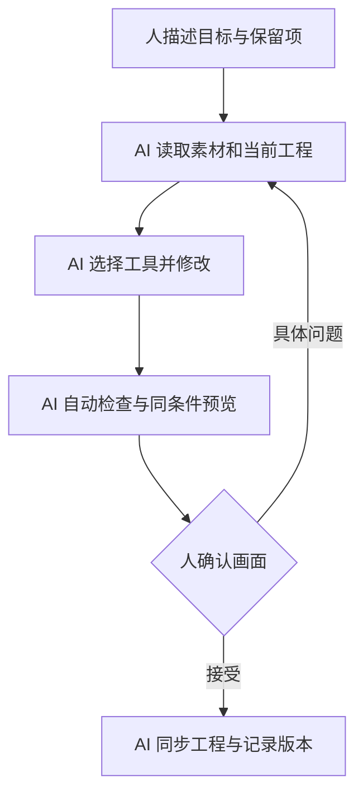

# 我们怎样用 AI 做完整个 Live2D 制作流程

[返回目录](../README.md)

这是一份 OC 娘的制作实录。AI 贯穿角色设计、美术素材、绑定工程、动作、Web 接入和验证；人的核心输入是方向选择与视觉反馈。每轮迭代都落到具体图稿、工程、脚本或预览，而不是只给一段操作建议。

本页主线记录截至 2026-10-20 的单主模型与统一换装阶段。后续暗夜被明确为独立角色，新增原画重建、独立表演和角度素材；这改变了“继续复用旧脸”的取舍，详见[后续经验与结论修订](14-night-character-lessons.md)。早期成果保留为历史，不作为新版全部动作已经交付的证据。

## 1. 从角色意图开始，AI 生成设计候选

日常 OC 娘的方向是阳光、亲和的大姐姐；暗夜版希望冷艳、沉静，与网页暗色主题协调。

工作方式是人给角色意图和需要保留的身份特征，AI 把它展开为服装、发型、配色和材质要求，使用图像生成工具给出候选。用户选择暗夜 C 方案后，再以确认稿继续制作。

这个阶段保留完整参考图和生成要求。概念图可以有背面、近景和配饰细节；正式拆层底图需要确定裁切、比例、姿态与透明背景。两者用途不同。

**产物：** 设计候选、选定底图、保留特征清单、生成记录。

## 2. AI 出图之后，继续用 AI 整理可绑定素材

单张漂亮插画还缺隐藏部分、独立眼眉嘴和关节重叠区。AI Agent 根据动作需求拆解任务，再编写 Python / JavaScript 处理程序，完成裁切、遮罩、尺寸配准、图集和 PSD 等准备。

需要新像素时，回到图像编辑：补完整发尾、修掌心和握拳、连贯肩袖布料、清理书边与腕口。需要精确坐标和一致性时，交给确定性的图像处理脚本。

我们遇到过请求透明图却得到画入棋盘格的 RGB 图。Agent 必须检查实际通道；工作底图可以用于后续提取，但不能作为透明素材直接交付。

另一个例子是袖口候选虽然更自然，却顺带改了手指。最终保护原手指与皮肤，只取生成结果中的局部布料修补。

**产物：** 原图、生成候选、实际采用区域、配准素材、回合成图和图集。

## 3. AI 写绑定与工程处理程序

我们的绑定工作包含 AI 编写的关键形采样、参数整理、网格与变形器组织、源工程更新和验证程序。稳定的工程基线由官方 Cubism 导入、保存等流程建立；结构变更回到官方 Editor 重开、保存并导出。

项目实录中的脚本族包括：

- `prepare-xingyou-refined-native.mjs`：准备待机绑定数据；
- `sample-xingyou-native-keyforms.mjs`：采样原生关键形；
- `build-xingyou-refined-cmo.py`：将数据写入基于 Cubism 导入的源工程；
- `finalize-xingyou-native-keyforms.py`：更新关键形；
- `validate-xingyou-refined-native.mjs`：检查导出后的运行结果。

这些名称用于说明真实产物类型，原项目脚本未包含在本公共仓库。它们对源工程版本有依赖，不能当作通用稳定的 CMO3 API。AI 生成的结构编辑也必须经过官方保存和目标 Core 验证。

**AI 的作用是把重复工程操作变成可检查程序。** 例如二维关键形排列错误可以导致插值问题；脚本“写入成功”之后，还要实际采样九向和中间状态。

**产物：** 参数契约、关键形数据、源工程候选、官方导出文件、数值报告。

## 4. 用人的观感驱动 AI 修复绑定

用户反馈“脸被拉扁”“只是在平移”“没有原待机那么甜”“右眼还差一点”，这些都不能简化成一个通过/失败的程序断言。

Agent 的工作是把观感拆成可检查的问题：

| 反馈 | AI 进一步定位与实施 |
|---|---|
| 转头压扁 | 检查整体缩放，分开脸轮廓、五官、耳与前后发 |
| 眼睛不像底图 | 同角度对齐眼裂、睫毛、虹膜露出和眉眼距离 |
| 脖子长 | 对齐下巴、颈底和领口，调整过渡而非重画整脸 |
| 大臂像贴上去 | 统一连续袖料，增加肩部与衣身轻联动 |
| 袖口有绿块 | 逐层定位源素材，局部修补并保护手指 |

每轮先建立可比较的前后版本，再让人决定是否采用。AI 既写修复，也写非目标部件检查；视觉最终仍由人确认。

## 5. AI 编排动作，再把动作整合成一个主模型

九个动作逐步制作和接回新版待机，随后整合为一个原生主模型。AI 编写资产盘点、参数重命名/映射、动作导出、统一控制与回归检查，避免继续维护彼此漂移的预览。

鼠标输入驱动眼、头、身的不同响应；发尾采用有阻尼的轻摆；动作时钟单独调整节奏。挥手、鼓励、崇拜加快，思考、害羞、失落保留情绪停顿并缩短准备和收尾。

思考的问号、崇拜的星星眼与张嘴、倾听的前倾和轻点头，都属于需要单独保护的已确认表现。

**产物：** 一个主模型、九份动作、统一参数驱动、动作节奏和回归记录。

## 6. AI 把换装做成系统，而不是只换一张图

AI 根据发型、服装、饰品三类配置建立全动作覆盖表。暗夜服装需要替换的不只是衣身，还有抬手袖子、翻书腕口、含布料的手部图和崇拜特殊姿态。

早期“参数都能动”的检查没发现混合素材里仍有白衣袖口，之后增加了像素与视觉覆盖检查。这个教训说明，Agent 的测试范围也要随着失败案例升级。

**产物：** 外观配置、部件映射、原生外观参数、加载/提交逻辑和九动作验证。

## 7. AI 实现 Web 接入、高清和主题转场

Agent 编写实际产品宿主代码，处理模型加载、鼠标跟随、动作选择、主题外观、高清渲染与资源释放。独立预览和产品入口共用实现，避免一个修好另一个落后。

转场同样先设计再实现：人提出烟雾与明星登场的感觉，AI 生成分镜候选；确认后编写两侧追光汇聚、烟雾散去和光圈停留。回日常后来改成翻页迎晨，再修正亮色背景下的黑色矩形。

**产物：** 产品接入代码、同尺寸高清对照、双向转场、本地动作预览。

## 8. AI 负责检查和记录，人确认可见结果

Agent 执行文件哈希、参数探测、九向组合、局部顶点差异和动作端点检查；通过浏览器看全身、脸部、肩袖与腕口，保存同条件对照。

后续侧脸案例表明，数值通过也可能被视觉验收否定；退出动作还要逐帧检查可达路径，不能只看回到默认值的终点。AI 编写的测试必须随这些反例修订，且最终导出、浏览器复验和用户确认分别记录。

发现错误后继续改实现；通过后同步源工程和运行资产，记录是“本地同步”还是已完成其他发布步骤。当前公开案例不据此宣称产品已上线。

这条反馈链可以重复用于自己的角色：

## 实际工具分工

| 工具角色 | 本项目使用方式 |
|---|---|
| AI Agent（Codex） | 研究、拆任务、写程序、操作可用工具、验证和整理交付 |
| 内置图像生成/编辑（image_gen） | 角色、服装、发型、表情与局部修补候选 |
| Python / Node.js 图像与数据脚本 | 精确配准、遮罩、图集、关键形、工程整理与一致性检查 |
| Cubism Editor / Core | 官方编辑、保存、原生导出与运行数据验证 |
| 浏览器自动化与预览 | 检查真实页面动作、换装、透明背景和控制台 |
| 人 | 给方向、选方案、确认神态与自然度、完成许可操作 |

See-through、PSD2Live 等在这里属于另外的调研路线，不能写成我们的资产已经全部经过它们生产。对应证据见 [AI 制作记录](../references/ai-evidence.md)。

我们没有一份完整统计来证明节省了多少工时，也没有公开通用一键生成器。可复用的是这条 AI 全流程执行、可检查产物与人的视觉反馈相结合的制作方法。
